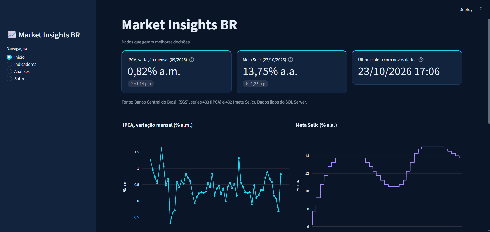
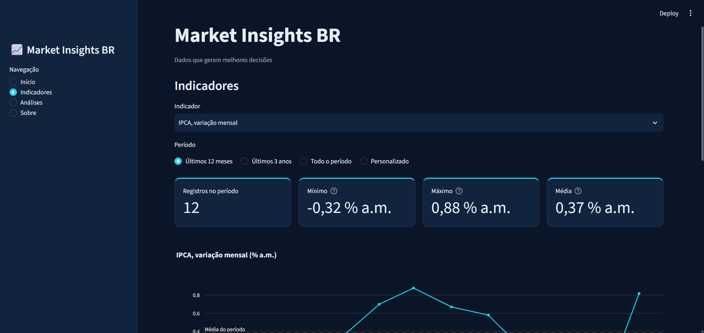
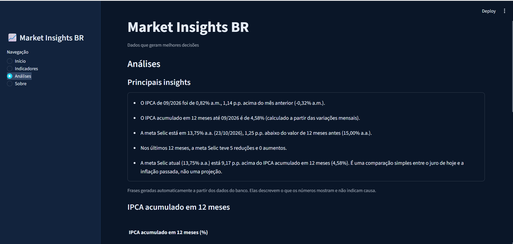

# Market Insights BR

Dashboard de indicadores econômicos brasileiros (IPCA e meta Selic), com dados oficiais do Banco Central, armazenados em SQL Server e apresentados com Streamlit e Plotly.

> **Dados que geram melhores decisões.**

Projeto de portfólio que mostra o caminho completo dos dados: coleta em fonte oficial, tratamento, armazenamento, análise e visualização.



## O que o projeto faz

- Consulta a API pública do Banco Central (SGS) e guarda o histórico no SQL Server, sem duplicar registros.
- **Início:** cards com o último IPCA e a meta Selic atual, gráficos históricos e tabela dos dados mais recentes.
- **Indicadores:** escolha do indicador, filtro de período, estatísticas (mínimo, máximo e média) e tabela.
- **Análises:** IPCA acumulado em 12 meses (calculado a partir das variações mensais), comparativos entre períodos e insights escritos automaticamente a partir dos dados.
- **Sobre:** objetivo, tecnologias, fontes, cobertura dos dados e limitações.

| Indicadores | Análises |
|---|---|
|  |  |

## Como os dados percorrem o projeto

```
API do Banco Central → Requests → Pandas → SQL Server → Streamlit + Plotly
                                              ↑
                                      atualizar_dados.py
```

1. `atualizar_dados.py` consulta a API, trata os dados com Pandas e grava só os registros novos no SQL Server.
2. O dashboard lê **apenas o banco**. Mexer nos filtros nunca dispara uma nova consulta à API.
3. A leitura do banco fica em cache por 10 minutos.

## Tecnologias

Python 3.12, Requests, Pandas, NumPy, SQL Server, pyodbc, SQLAlchemy, Streamlit, Plotly e Pytest.

## Fontes de dados

Banco Central do Brasil, Sistema Gerenciador de Séries Temporais (SGS):

- **Série 433:** IPCA, variação mensal (% ao mês).
- **Série 432:** meta Selic definida pelo Copom (% ao ano), com um valor por dia corrido.

## Estrutura do projeto

| Arquivo | Função |
|---|---|
| `app.py` | Interface Streamlit: páginas, filtros e gráficos |
| `database.py` | Conexão e operações com o SQL Server |
| `data_ingestion.py` | Coleta na API e tratamento com Pandas |
| `atualizar_dados.py` | Atualiza o banco (rodar no terminal) |
| `analysis.py` | Cálculos e geração dos insights |
| `sql/criar_banco.sql` | Cria o banco e a tabela |
| `tests/` | Testes automáticos com pytest |
| `.streamlit/config.toml` | Tema escuro do dashboard |

## Como executar

**Pré-requisitos:** Windows, Python 3.12, SQL Server com autenticação do Windows e o **ODBC Driver 18 for SQL Server**.

1. Instale as dependências:
```
   python -m pip install -r requirements.txt
```
2. Execute `sql/criar_banco.sql` no SSMS para criar o banco `MarketInsightsBR` e a tabela `dbo.indicadores`.
3. Se o seu servidor não for `localhost`, ajuste `SERVIDOR` no início de `database.py`. A conexão usa autenticação do Windows, então não há senha no código.
4. Carregue os dados (por padrão, os últimos 5 anos):
```
   python atualizar_dados.py
```
5. Abra o dashboard:
```
   python -m streamlit run app.py
```

Para atualizar os dados no futuro, rode o passo 4 de novo. Só os registros novos são gravados.

## Testes

```
python -m pytest -v
```

Os testes cobrem o tratamento dos dados e os cálculos de `analysis.py`, como o IPCA acumulado em 12 meses, sem precisar de internet nem de banco.

## Limitações

- A atualização é manual, e os dados só mudam quando `atualizar_dados.py` é executado.
- Só entram datas novas. Se o Banco Central revisar um valor antigo, o banco não é corrigido.
- O IPCA acumulado em 12 meses é calculado neste projeto e pode diferir em centésimos do número oficial por arredondamento.
- A Selic mostrada é a meta definida pelo Copom, e não a taxa efetivamente praticada.
- IPCA mensal (% a.m.) e Selic (% a.a.) têm unidades diferentes. A comparação usa o IPCA acumulado em 12 meses.
- Os insights são descritivos, sem previsão, e correlação entre indicadores não significa causalidade.
- O banco guarda 5 anos de histórico.

## Próximas melhorias

- Incluir dólar e PIB.
- Comparar o IPCA acumulado calculado com a série oficial do Banco Central.
- Agendar a atualização dos dados.
- Testes de integração com o banco.

## Autoria

Amanda Lorenço, [GitHub](https://github.com/Amandalo12)